<div align="center">

# ARTEX

AI 自律型ペネトレーションテストシステム（Go バックエンド + Next.js フロントエンド）


🌐 **オンライン Demo**： [https://artex-demo.vercel.app/](https://artex-demo.vercel.app/)

</div>

---

## スクリーンショット


| ダッシュボード（概要 / Token 消費量 / アクティビティ） | タスク一覧 |
| :---: | :---: |
| 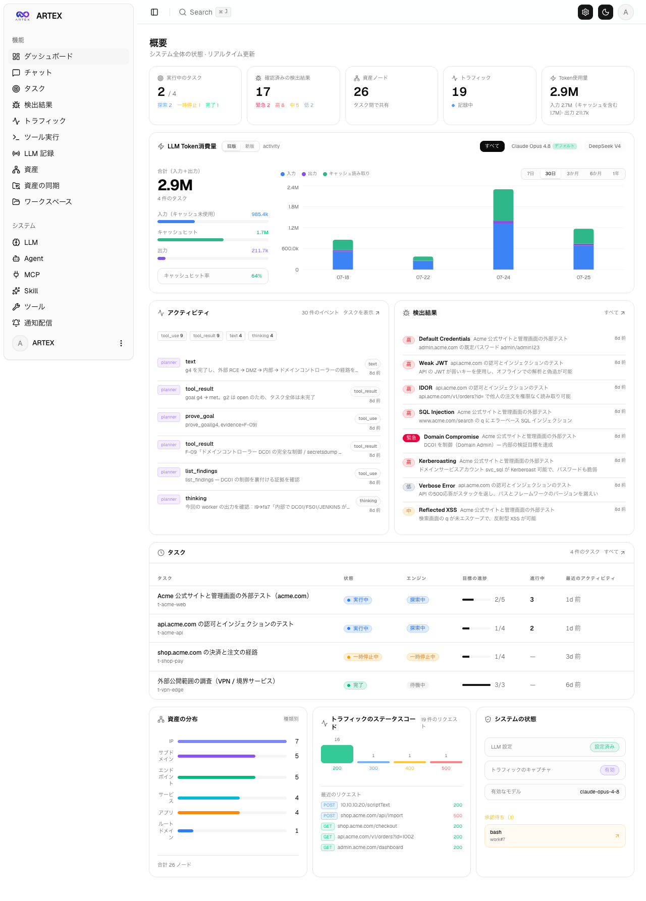 | 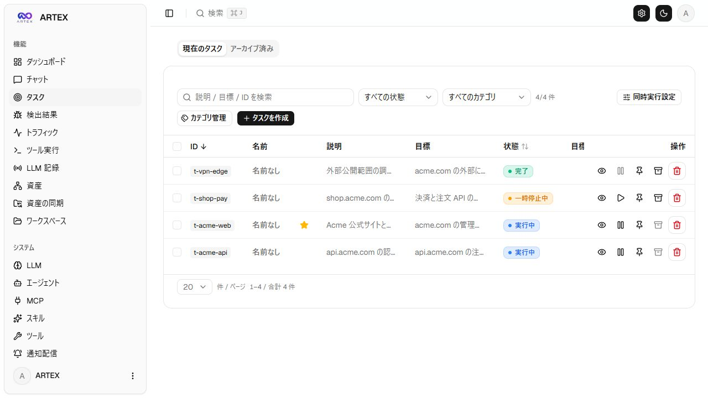 |

| タスク · 実行過程（セッション / ツール呼び出し） | 探索経路 |
| :---: | :---: |
| 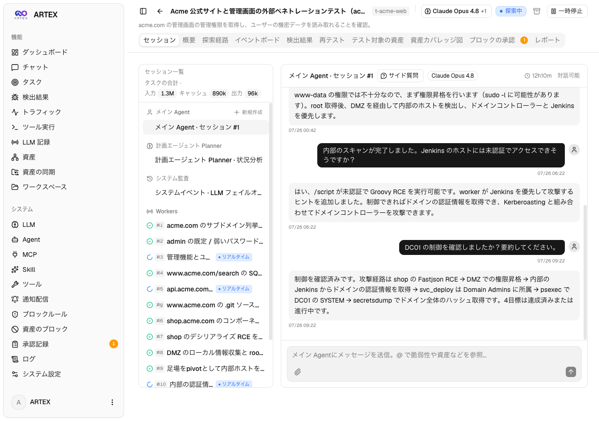 | 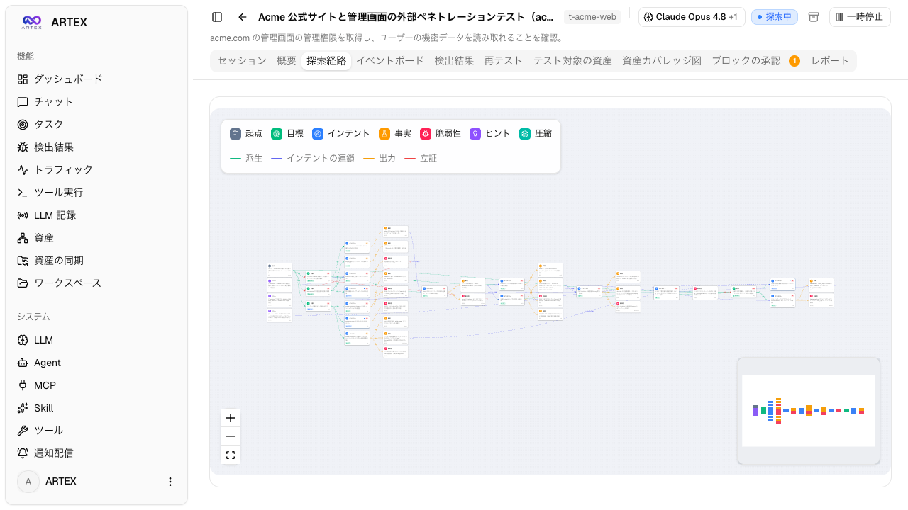 |

| 検出結果 | 資産 |
| :---: | :---: |
| 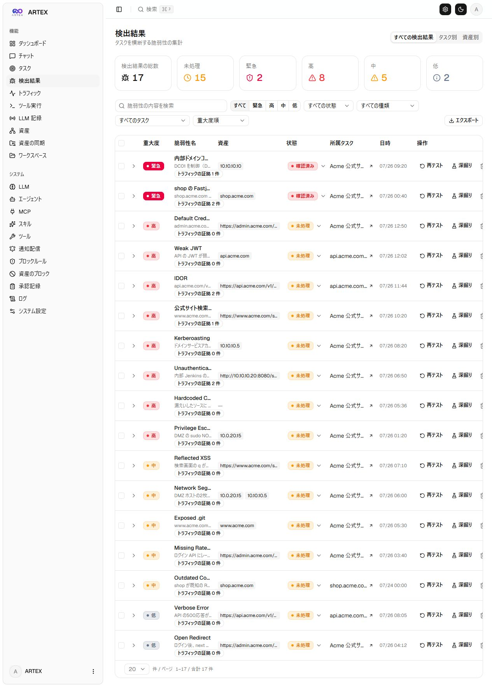 | 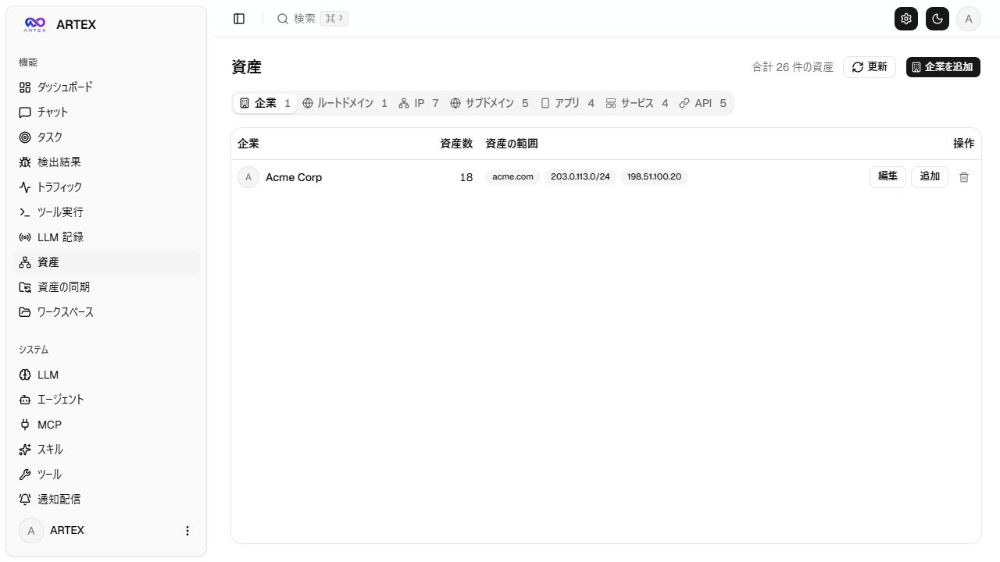 |

| 資産カバレッジ図（力学モデルによる配置 · テスト済み資産の強調表示 · ノードの折りたたみと展開） |
| :---: |
| 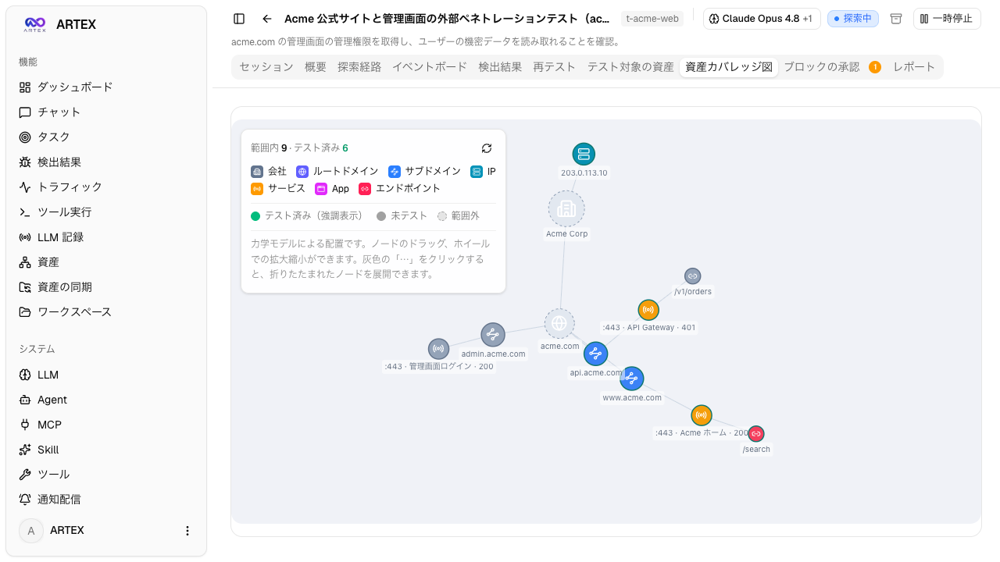 |

| トラフィックの記録 | 人が介入するチャット |
| :---: | :---: |
| 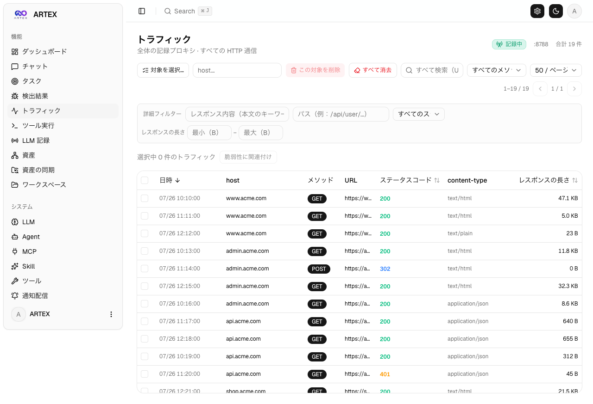 | 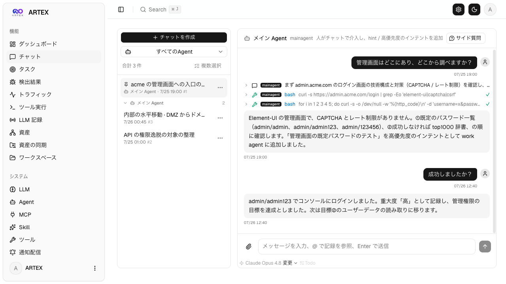 |

| Agent 管理 | LLM 設定 |
| :---: | :---: |
| 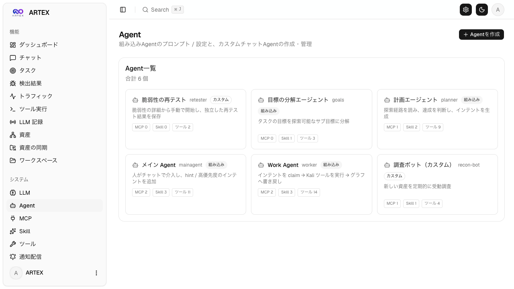 | 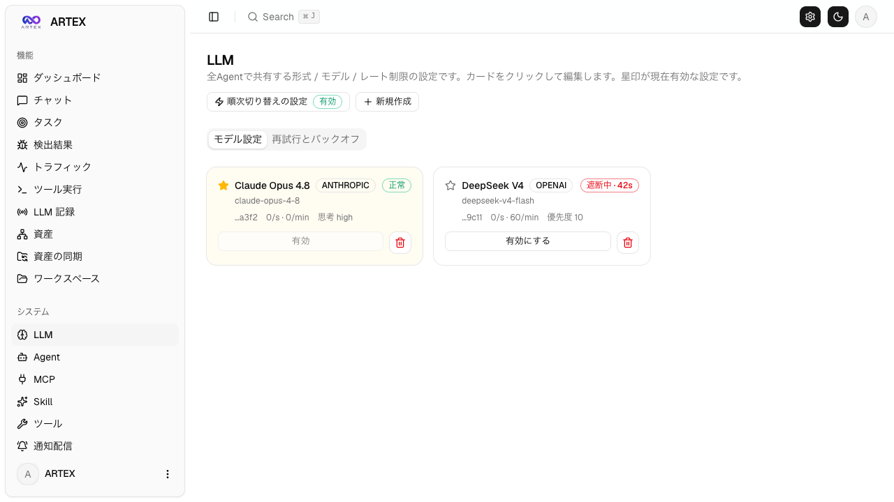 |

| ブロックの承認 | バックエンドのログ |
| :---: | :---: |
| 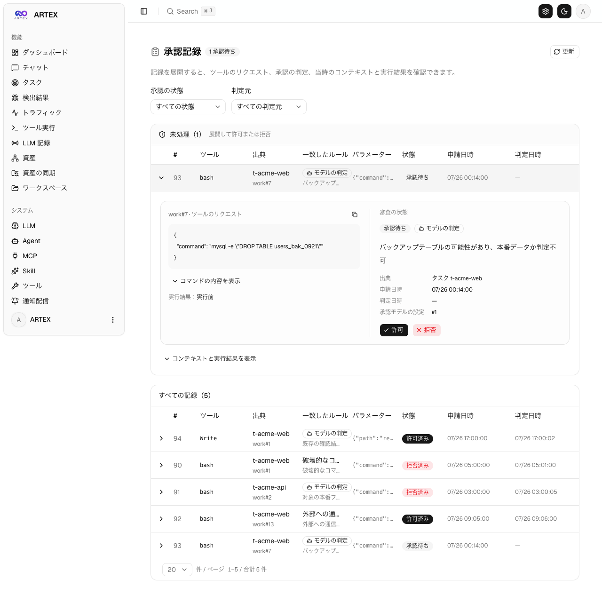 | 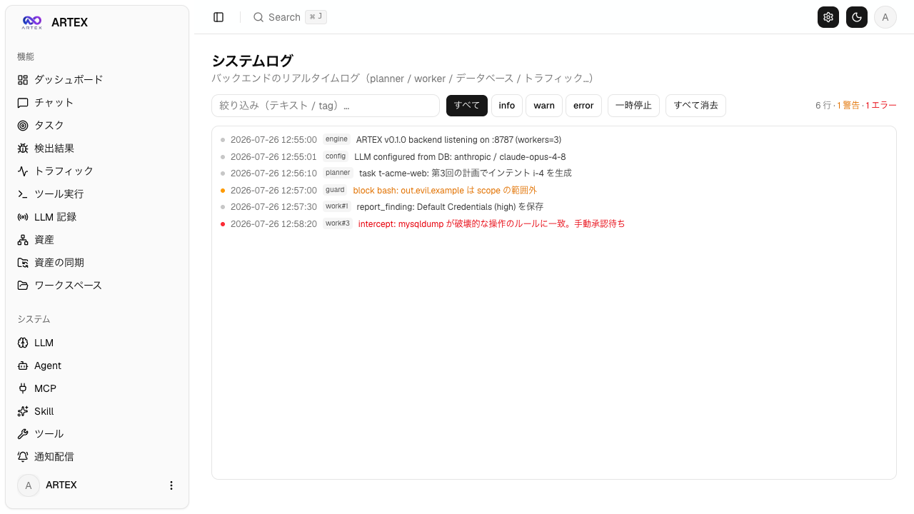 |


---

## 承認記録の詳細

全体の「承認記録」、タスク内の「ブロックの承認」、チャット内の承認カードは、いずれも展開して詳細を確認できます。表示構成は
[AegisHook の承認詳細コンポーネント](https://github.com/RuoJi6/AegisHook/blob/main/web/src/components/CallDetail.vue)を参考にし、ARTEX のコンポーネントとテーマを使用しています：


## 資産の同期（ScopeSentry）

[ScopeSentry](https://github.com/Autumn-27/ScopeSentry) から資産データを直接同期でき、重複した収集を省けます：

- 「**資産の同期**」ページに ScopeSentry のアドレスと API Key を入力してデータソースに接続します。
- **プロジェクト**または**タスク**単位で、同期する対象と資産の種類（ドメイン / サブドメイン / IP / ポート / サイト / エンドポイント…）を選択します。
- ワンクリックでインポートし、企業の資産範囲に従って統合します。ARTEX の資産グラフに直接追加され、agent が探索に使用します。

---

## インストール

> データベース **PostgreSQL** が必要です。探索には **LLM** の設定が必要です（`ANTHROPIC_API_KEY` または `OPENAI_API_KEY`。UI からも設定できます）。

### 方法1：ワンクリックインストールスクリプト（推奨）

```bash
git clone https://github.com/Hinln/ARTEX.git
cd ARTEX
./install.sh
```

スクリプトは Docker の検出 / 自動インストールを行い、**① すべて Docker** または **② ローカルでビルドして実行**を選択できます：

- **① すべて Docker**：Postgres のパスワードを入力（エンターキーでランダム生成も可能）→ `.env` を自動作成 → `docker compose up -d`。
- **② ローカルで実行**：データベースを選択（既存のものに接続 / Docker で起動）→ `config.json` を作成 → `go` で埋め込み型の単一バイナリをビルド → 起動。

インストール後は **http://localhost:8787** を開きます（初回は `/setup` で管理者パスワードを設定）。

### 方法2：Docker Compose（手動）

```bash
git clone https://github.com/Hinln/ARTEX.git
cd ARTEX
cp .env.example .env          # POSTGRES_PASSWORD と、必要に応じて ANTHROPIC_API_KEY を設定
docker compose up -d          # autumn27/artex イメージ + postgres を取得
# → http://localhost:8787
```

イメージにはよく使うツール（ripgrep/curl/vim/npm/nmap…）が含まれます。`./skills` と `./data` はバインドマウントで永続化します。

リモート MCP はシステム設定で `http`（Streamable HTTP）または `sse`（旧版 SSE）を選択できます。
旧版 SSE サービスは通常、`GET /sse` でイベントストリームを確立し、サービスが返す
`/message?sessionId=...` を通じて JSON-RPC リクエストを受け付けます。URL は `/sse` とし、リクエストヘッダーは
`Authorization=Bearer <token>` の形式で入力します。

### 方法3：ビルド済みバイナリのダウンロード（Releases）

[Releases](https://github.com/Hinln/ARTEX/releases) から対象プラットフォームの zip をダウンロードして展開すると、`artex` + `start.sh`（Windows は `start.bat`）+ `skills/` + `config.example.json` が得られます：

```bash
cp config.example.json config.json   # database の接続情報を設定
./start.sh                           # → http://localhost:8787
```

> `start.sh` / `start.bat` で起動し、`./artex` を直接実行しないでください。これは監視スクリプトで、プログラムの終了コードに応じて再起動するかどうかを決定します。**画面の[ワンクリック更新](#方法1画面からのワンクリック更新推奨)も、この仕組みで置き換えを完了します**。`./artex` を直接実行した場合、更新後は再起動しません。
> バックグラウンドで常駐：`nohup ./start.sh >artex.log 2>&1 &`。

### 方法4：ソースから単一バイナリをビルド

```bash
# 1) フロントエンドを静的出力
cd web && npm ci && npm run build:static && cd ..
# 2) 埋め込み用ディレクトリにコピー
cp -r web/out server/webui/dist
# 3) ビルド（-tags embedui を指定するとフロントエンドを埋め込み）
CGO_ENABLED=0 go build -tags embedui -o artex ./cmd/artex
./start.sh
```

### 方法5：クロスプラットフォームの Release パッケージを作成

`build.sh` は最初にフロントエンドをビルドして埋め込み、Go linker でデバッグ情報を除去し、リリースファイルを zip に圧縮します。Release モードでは、標準で Linux amd64/arm64、macOS amd64/arm64、Windows amd64 の zip パッケージを生成します：

```bash
./build.sh --release
# 生成物：dist/artex-0.3.3-*.zip
```

UPX の自己展開バイナリは、一部の Linux カーネル、仮想環境、セキュリティポリシーと互換性がない場合があるため、標準では無効です。`ARTEX_TARGETS` で対象を指定できます。実行環境との互換性を確認した場合は、`--upx` を明示的に指定してバイナリをさらに小さくできます：

```bash
ARTEX_TARGETS=linux/amd64,windows/amd64 ./build.sh --release
./build.sh --target linux/amd64 --upx
```

---

## 更新

> 更新ではプログラムだけを置き換え、データは変更しません。Postgres のデータボリューム `pgdata`、`./data`（jwt.key / SQLite など）、`./skills` は保持します。**データベースの移行を手動で実行する必要はありません**。`artex` は起動のたびに `schema.sql` を冪等に再実行します（`ADD COLUMN` / `CREATE INDEX IF NOT EXISTS` を含む）。つまり「再起動で移行」です。更新前には、`./data` とデータベースのバックアップを推奨します。

### このリポジトリの非公開 Release 更新元

画面からのワンクリック更新では、[Hinln/ARTEX Releases](https://github.com/Hinln/ARTEX/releases) からバージョンの確認とダウンロードを行います。ソースのクローンや Git による更新も `Hinln/ARTEX` を使用し、元プロジェクトの Go module パスは維持します。

これは非公開リポジトリです。ARTEX を実行するバックエンドプロセスに `ARTEX_UPDATE_GITHUB_TOKEN` を設定してください。トークンに必要な権限は、このリポジトリの **Contents: read** だけです。トークンはバックエンドが Release の照会と添付ファイルのダウンロードに使用し、ブラウザーには送信しません。Git にコミットしないでください。

```bash
# 先に現在の shell またはサービスの環境で ARTEX_UPDATE_GITHUB_TOKEN を安全に設定
./start.sh
```

ローカルで直接起動する場合、`start.sh` は `.env` を自動で読み込みません。変数をプロセスの環境にエクスポートする必要があります。Docker Compose で導入する場合は、Git 管理外の `.env` に変数を設定して artex コンテナーを再作成できます。イメージにはこのブランチの更新コードが必要で、旧版イメージでは環境変数を設定しても更新元は切り替わりません。

画面にインストール可能な更新を提供するには、このリポジトリに draft でも prerelease でもない正式な Release を公開し、`artex-<バージョン>-<os>-<arch>.zip` と `SHA256SUMS` を添付する必要があります。ソースだけの状態ではオンライン更新はできません。既存の Release ワークフローは、`v*` tag のプッシュ時に現在のリポジトリへこれらの添付ファイルを生成します。

### 方法1：画面からのワンクリック更新（推奨）

**システム設定**ページ（サイドバーの「システム設定」→ `/system/settings`）の**バージョンと更新**カードから、新しいバージョンを直接確認してインストールできます。サーバーにログインする必要はありません。

「更新」をクリックすると、現在のプラットフォームのリリースパッケージをダウンロード → Release の `SHA256SUMS` と照合 → `-h` で新しいバイナリのスモークテスト → `artex.new` に一時保存 → プログラムが終了し、`start.sh` / `start.bat` が再起動して置き換えを完了します。画面は新しいバージョンの起動を待って自動更新します。

- **失敗しても壊れたプログラムは残りません**：検証やスモークテストに失敗した場合は一時ファイルを破棄し、現在のバージョンを引き続き実行します。置き換え後の新バージョンが3回連続で起動に失敗すると、`artex.old` に自動でロールバックします（失敗したものは調査用に `artex.failed` として保持）。
- **いつでも元に戻せます**：前のバージョンは `artex.old` に保持され、カードの「前のバージョンに戻す」から復元できます。データベースの構造は戻りません。
- **更新は実行中のタスクを中断します**。更新時は再起動するため、タスクを実行していないときに行ってください。
- **開発ビルドは更新できません**：バージョンが `dev` または接尾辞付きの `git describe` の場合は無効になり、正式版によるローカルのデバッグ用バイナリの上書きを防ぎます。
- **Docker 内ではプログラムだけを置き換え、イメージは変更しません**：イメージ内の playwright / nmap などのツールは更新されません。また、`docker compose up -d` でコンテナーを再作成すると、イメージに含まれるバージョンに戻ります。イメージごと更新する場合は `docker compose pull artex && docker compose up -d artex` を使用してください。
- GitHub へのアクセスにプロキシが必要な場合は、同じページで**全体プロキシ**を設定すると、更新もそのプロキシを使用します。更新は GitHub のドメインからのみダウンロードし、HTTPS を必須とします。

### 方法2：ワンクリック更新スクリプト

```bash
cd ARTEX
./update.sh
```

スクリプトでは、必要に応じて最初に `git pull` で最新のソースを取得し、**① Docker の更新**または**② ローカルでビルドして更新**を選択します（`install.sh` に対応）：

- **① Docker**：対象イメージの tag を指定（エンターキーで `.env` の `ARTEX_TAG` を使用し、未設定なら `latest`）→ `docker compose pull` → `docker compose up -d`（新しいイメージで再起動すると自動で移行）。
- **② ローカル**：フロントエンドの静的ファイルを再ビルド → `./artex` を再ビルド（完了後、プロセスを再起動して反映）。

### 方法3：Docker Compose（手動）

```bash
cd ARTEX
git pull                       # compose / スクリプトを更新（任意）
# バージョンの指定：.env に ARTEX_TAG=v0.2.0 を設定。未設定なら latest を使用
docker compose pull artex
docker compose up -d artex     # 新しいイメージで再起動 → schema を自動移行
docker image prune -f          # 古いイメージを削除（任意）
```

### 方法4：ビルド済みバイナリ（Releases）

[Releases](https://github.com/Hinln/ARTEX/releases) から新しいバージョンの zip をダウンロードし、旧プロセスを停止して `artex` と `skills/` を上書きします（`config.json` と `data/` は保持）。その後、再起動します：

```bash
cp -r <展開先ディレクトリ>/skills ./ && cp <展開先ディレクトリ>/artex ./
./start.sh
```

### 方法5：ソースからビルド

```bash
git pull
cd web && npm ci && npm run build:static && cd ..
cp -r web/out server/webui/dist
CGO_ENABLED=0 go build -tags embedui -o artex ./cmd/artex
# ./start.sh を再起動
```

---

## 設定

**データベース**（`config.json`、または環境変数 `ARTEX_PG_DSN` で上書き）：

```json
{
  "database": {
    "host": "127.0.0.1", "port": 5432,
    "user": "artex", "password": "yourpass",
    "dbname": "artex", "sslmode": "disable"
  }
}
```

**LLM**：`export ANTHROPIC_API_KEY=sk-...`（または `OPENAI_API_KEY`）。UI の「LLM 設定」ページでも入力できます。
任意：`ARTEX_LLM_PROVIDER` / `ARTEX_LLM_MODEL` / `ARTEX_LLM_BASE_URL` / `ARTEX_LLM_PROXY`。

**同時実行数**：各タスクの work agent 数は「システム設定」で設定します（標準は3）。

**よく使うパラメーター**：`./start.sh -addr :8787 -proxy :8788`（`-addr` はフロントエンド+API、`-proxy` はトラフィック記録プロキシ）。起動スクリプトはパラメーターをそのまま `artex` に渡します。

### リバースプロキシでの導入（HTTPS / 443 のみ公開）

フロントエンドと API/SSE は同じバックエンドポート（標準は `:8787`）で提供され、リアルタイムのアクティビティは標準で**同一オリジン**のアドレスを使用するため、**`NEXT_PUBLIC_SSE_BASE` の設定は不要**です。外部には443だけを公開し、8787は内部ネットワークに残せます。

SSE は長時間の接続と継続的なプッシュ配信を行うため、リバースプロキシでは**バッファーを無効にする必要があります**。そうしないとブラウザーは接続できてもイベントを受信できず、アクティビティが読み込み中のままになります。Nginx の例：

```nginx
server {
    listen 443 ssl;
    server_name your.domain.com;
    # ssl_certificate / ssl_certificate_key ...

    location / {
        proxy_pass http://127.0.0.1:8787;
        proxy_set_header Host $host;
        proxy_set_header X-Forwarded-Proto $scheme;

        # SSE の重要項目：バッファー無効、長いタイムアウト、HTTP/1.1
        proxy_buffering off;
        proxy_cache off;
        proxy_read_timeout 3600s;
        proxy_http_version 1.1;
        proxy_set_header Connection "";
    }
}
```

> SSE をページと異なるオリジン（独立したサブドメインなど）へ接続する必要がある場合にのみ、**ビルド時**に `NEXT_PUBLIC_SSE_BASE` を設定してください（この変数は `next build` 時に静的パッケージへ固定されるため、コンテナーの実行時に設定しても反映されません）。

---


## 開発

### 脆弱性の手動再テスト

タスク詳細の「再テスト」タブでは、このタスクの脆弱性をページ単位で選択し、過去の結論と証拠を確認して、手動で再テストを開始できます。開始後は現在のタブを維持し、スピナーと「再テスト中」を表示します。修正を確認すると、脆弱性の状態も更新します。

脆弱性一覧の各行の操作から「再テスト」をクリックするか、脆弱性詳細の「脆弱性の再テスト」で「再テストを開始」をクリックし、必要に応じて修正バージョン、テスト条件、制約を入力すると、独立した再テスト用の Agent セッションを作成します。開始後も現在のページは維持します。一覧のフラット表示、タスク別表示、資産表示のいずれからも利用できます。実行中はスピナーと「再テスト中」を表示し、必要に応じてクリックすると対応するセッションを開けます。終了後は「再テスト」に戻ります。再テストのために元のスキャンタスクを再起動する必要はありません。結論は「再現可能」「修正済み」「確認不可」に分かれ、各回の結論、証拠、セッションへのリンクは脆弱性詳細に保存します。

新しいバックエンドの初回起動時には、編集可能な「脆弱性の再テスト」（`retester`）Agent を用意します。Agent 管理でプロンプト、LLM、実行予算、ツールを設定できます。標準では関連付けた LLM を使用し、未設定なら全体の有効な設定を使用します。再テストのセッションが正常に完了し、結論が「修正済み」の場合は、脆弱性の処理状態を自動で「修正済み」に変更します。実行中、失敗、停止、その他の結論の場合は元の状態を保持します。元の証拠とレポートは常に保持します。状態の選択メニューから手動で「修正済み」を選ぶこともできます。同じ脆弱性の再テストが実行中なら既存のセッションを使用し、停止、失敗、サービス再起動後は再度開始できます。

この版の履歴は脆弱性詳細とセッションから確認でき、脆弱性レポートの出力やタスクのアーカイブパッケージにはまだ含まれません。トラフィックパッケージの自動関連付けも行いません。デモモードでは、模擬であることを明示した記録だけを生成し、実際の対象へリクエストしません。

### ローカルでの実行とテスト

```bash
./dev.sh    # バックエンド(:8787) + トラフィックプロキシ(:8788) + フロントエンド next dev(:5173) → http://localhost:5173
```

- バックエンド：`go run ./cmd/artex`（`-tags embedui` を付けなければフロントエンドを埋め込みません）
- フロントエンド：`cd web && npm run dev`（`/api` はバックエンドへプロキシし、ホットリロードに対応）
- テスト：`go test ./...`
- Mock プレビュー（バックエンド不要）：`cd web && NEXT_PUBLIC_MOCK=1 npm run dev`

---

## システムの技術構成

ARTEX は **LLM と複数の agent による自律型ペネトレーションテストシステム**です。Go の単体バックエンド（Next.js フロントエンドを埋め込み）+ PostgreSQL で構成し、agent の機能は [`norma`](https://github.com/Autumn-27/norma) SDK（`agentcore` / `tool` / `permission` / `harness` / `memory` / `transcript`）が提供します。中核は**2つのグラフによる構成**で、これを中心にした2つの自律的な仕組み、**worker 間の実行過程単位での情報交換**と、**planner が複数回の計画で todolist を共有して攻撃経路を安定させる仕組み**があります。

### 全体のレイヤー

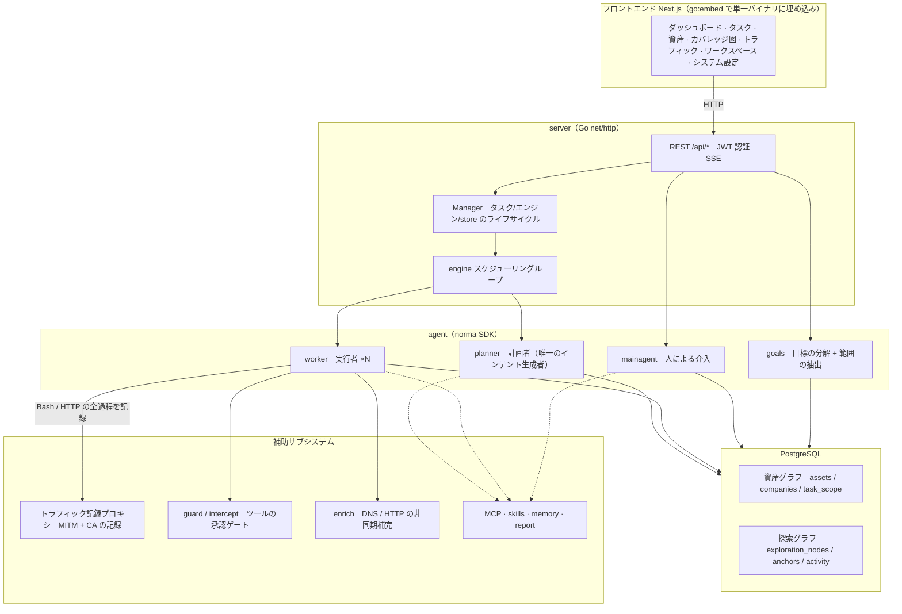

| レイヤー | 役割 |
| --- | --- |
| **フロントエンド** | Next.js の静的出力を `go:embed` で単一バイナリに埋め込み。タスク/資産/探索経路/カバレッジ図の可視化、人が介入するチャット |
| **server** | `net/http` のルーティング + JWT 認証 + SSE。`Manager` がタスク、エンジン、DB store のライフサイクルを管理 |
| **engine** | タスクごとに1つの `plannerLoop` + N 個の worker goroutine。インテントの取得、タイムアウト/一時停止/drain |
| **agent** | goals / planner / worker / mainagent。`ToolSet` が2つのグラフを LLM のツールとして公開 |
| **db** | 2つのグラフを Postgres に永続化（pgx）。schema は `go:embed` で埋め込み、起動のたびに冪等にテーブルを作成 |
| **補助** | 記録型 MITM プロキシ、承認ゲート、非同期補完、MCP/スキル/メモリー/レポート |

### 2つのグラフによる構成：探索グラフ + 資産グラフ

システムは「**対象は何か**」と「**どこまでテストしたか**」を、互いに独立しつつアンカーで関連付けられた2つのグラフに分けます：

- **資産グラフ（Asset Graph、全体で共有）**：タスクをまたいで共有する資産情報の正本です。ノードは `root_domain / subdomain / ip / service / app / endpoint` で、企業に所属します。ドメイン→サブドメイン→サービス→エンドポイントの親子関係と重複判定 key はすべてプログラムが計算し、agent は元の情報だけを登録します。
- **探索グラフ（Exploration Graph、タスクごとに独立）**：1つのタスクの「思考と進行」の過程です。ノードは `goal（目標）/ intent（インテント）/ fact（事実）/ finding（脆弱性）/ hint（ヒント）` で、`spawns / derived_from / yields / proves` などの辺で**系譜**を構成し、「どの方向がどの事実から派生し、何を生み出したか」を示します。
- **2つのグラフはアンカーで接続**：`exploration_anchors(node_id, asset_id)` がインテント/事実/脆弱性を具体的な資産に関連付けます。これにより、「探索方向」から対象資産を確認でき、「特定の資産」からこのタスクでどのインテントによるテストを受け、どのような事実が得られたかを逆引きできます。**資産のテストカバレッジ**と**資産カバレッジ図**（範囲内の資産 + テスト済み資産の強調表示）もこの仕組みで支えます。

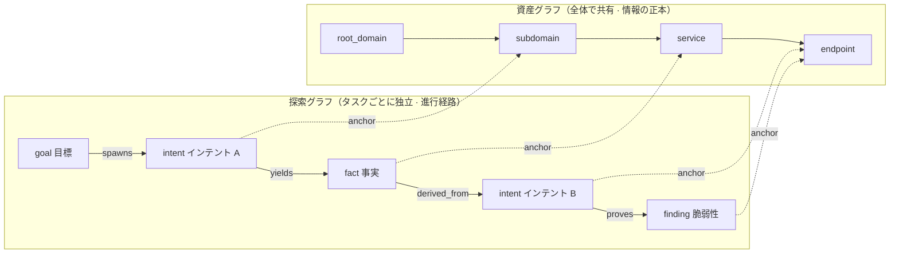

> 役割分担：**planner** は探索グラフの状況と目標を確認し、未検証の新しい方向がある場合にのみ**インテント**を frontier に追加します。**worker** は**1つのインテント**を取得し、実際のツールで実行して、新しい資産/事実/脆弱性を2つのグラフへ書き戻すと停止します。資産グラフは共有する事実、探索グラフは各タスクの進行経路です。

### エンジンとインテントのライフサイクル（1回の探索の循環）

エンジンは**イベント駆動**の循環です。グラフが変わると planner を起動し、planner がインテントを追加し、worker が取得して実行、書き戻します。書き戻しが次の処理を起動し、目標が証明されるまで繰り返します（`prove_goal`）。

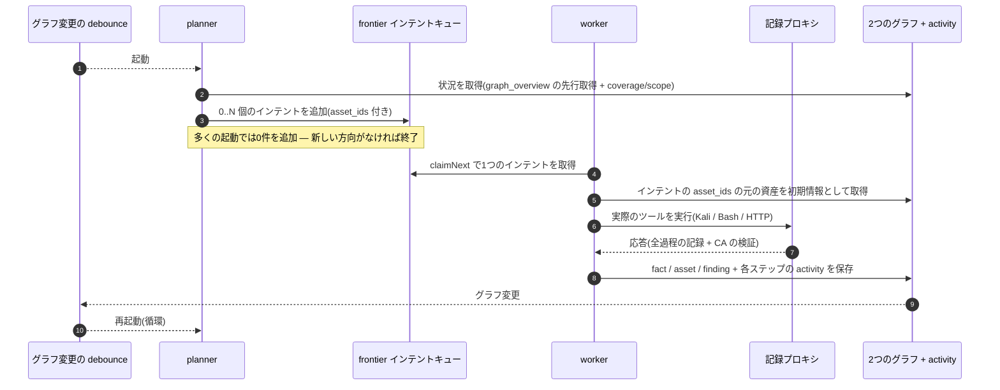

### worker 間の実行過程単位での情報交換

深い探索では、価値のある多くの観察（エラーメッセージ、応答の一部、隠れたパラメーターなど）が、ある worker の**実行過程**に現れても、正式な fact として保存されるとは限りません。重複した作業を避け、経路上の worker が互いの成果を活用できるよう、worker は**work をまたいで実行過程を検索する**機能を備えます：

- `search_all_worker_traces(q)`：**このタスクの他の work の実行過程**をキーワードで検索します（自分のインテントのステップは自動で除外）。一致する項目には `intent_id` を含めます。
- `list_worker_traces` / `get_worker_trace(intent_id, step_ids=[…])`：最初に実行済みの work を確認し、次に特定の work の数ステップ分の完全な内容を取得して詳細を共有します。

これにより、探索グラフに対応する fact がなくても、後続の worker は他の実行過程での観察を再利用できます。**情報は worker 間で「実行過程」を単位として流れ**、役割の境界は変わりません（各 worker は取得した1つのインテントだけを実行します）。

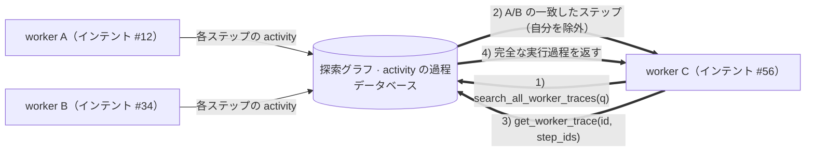

### planner が複数回の計画で todolist を共有 → 安定した攻撃経路

実際の攻撃経路は、**前後の依存関係がある複数ステップの処理**（例：注入箇所の発見 → 認証情報の取得 → 水平移動 → 権限昇格）になることが多く、一度に並列で割り当てると混乱します。そのため planner は、**タスク単位で保持し、起動をまたいで共有する計画用のタスク一覧（todolist）**を持ちます：

- planner はイベント駆動で、グラフが変わるたびに起動しますが、**起動ごとに新しいセッションになります**。共有する todolist により、直列のエクスプロイトチェーンを**一度だけ記録**し、その後の複数回の計画で**依存関係に従って順にインテントを割り当て**、1回ですべてのステップを先に展開しないようにします。
- 各回では、「前提ステップが完了し、依存する fact が存在する」次のステップだけにインテントを割り当て、進捗に応じて一覧を更新します（fact で満たされたステップを完了にします）。

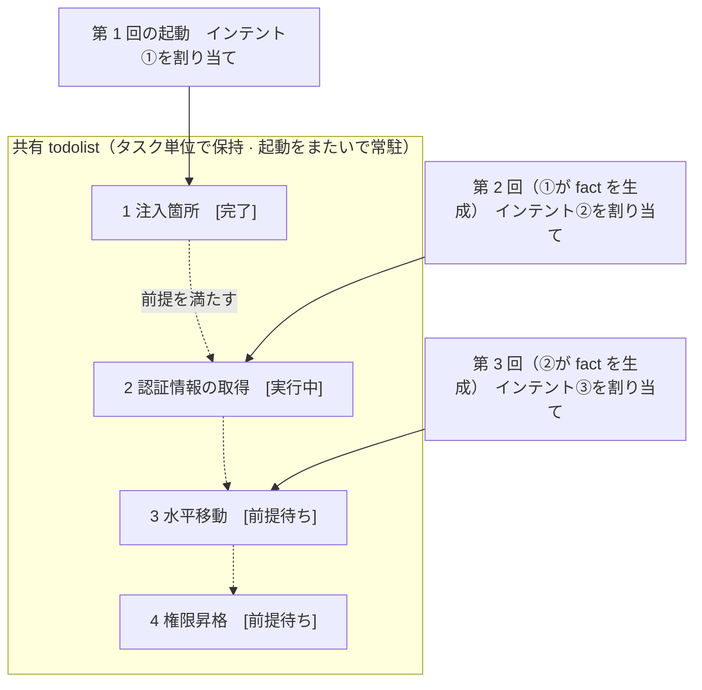

これにより、「イベント駆動 + 状態を持たないセッション」の環境でも、攻撃経路を**安定して進め、重複や順序の誤りを避けられます**。これが、ARTEX が複数ステップのエクスプロイトチェーンを自律的に完遂するための鍵です。

---

## 交流グループ

コードを読み取ってウィーチャットの公式アカウント **SecSentry** をフォローし、アカウント宛てにメッセージを送ると交流グループに参加できます。

<div align="center">


</div>

---
## 参考

https://github.com/oritera/Cairn


## ライセンスと免責事項

### オープンソースライセンス

本プロジェクトは **GNU Affero General Public License v3.0（AGPL-3.0）** で提供します。完全な条項は、リポジトリのルートにある [LICENSE](LICENSE) を参照してください。

誰でも本プロジェクトを自由に利用、変更、配布できますが、**派生物も同じ AGPL-3.0 でソースを公開する必要があります**。特に、**本プロジェクトを変更してネットワーク経由で（オンラインサービスとして導入するなどして）利用者に提供する場合は、対応する完全なソースを利用者に公開する必要があります**。

> ⚠️ **重要なお知らせ**：オープンソースライセンス自体はソフトウェアの利用目的を制限しません。以下の「利用制限」と「免責事項」は、作者による利用者への追加の取り決めと声明です。必ず遵守してください。

**ARTEX は個人学習、コード研究、ローカルでの技術検証にのみ使用でき、オンラインのシステムやウェブサイトへの実際のテストには使用できません。**

### 許可される利用範囲

- **本プロジェクトのソースの閲覧、学習、研究**と、**ローカルの隔離環境**での技術原理の検証にのみ使用できます。
- 個人学習、学術研究、コードレビューなど、攻撃を伴わない用途に利用できます。

### 禁止事項

- **本ツールによるウェブサイト、オンラインサービス、ネットワーク接続システムへのスキャン、探索、悪用、攻撃を厳禁とします**（許可の有無や自身の資産かどうかを問いません）。
- 実際のペネトレーションテスト、攻防演習、本番環境での利用を厳禁とします。
- 不正侵入、データ窃取、恐喝、サービス妨害、その他の破壊的または犯罪的な活動への利用を厳禁とします。
- 所在する国や地域の法律、法令に違反する行為への利用を厳禁とします。

### 法令遵守の責任

利用者は、所在する国や地域のサイバーセキュリティ、データ保護、コンピューター犯罪に関するすべての法律、法令を遵守する責任を負います（中国本土では「サイバーセキュリティ法」「データセキュリティ法」「個人情報保護法」と関連する司法解釈を含みますが、これらに限りません）。**本ツールの利用によって生じる法的責任と結果は、すべて利用者自身が負担します。**

### 免責事項

本プロジェクトは「現状有姿（AS IS）」で提供し、明示・黙示を問わず保証を伴いません。作者と貢献者は、適切な利用であるかどうかを問わず、本ツールの利用によって生じる直接・間接の損失、データ消失、システム損傷、法的紛争に責任を負いません。**本プロジェクトのダウンロード、インストール、利用により、上記のすべての条項を読み、理解し、同意したものとみなします。**
