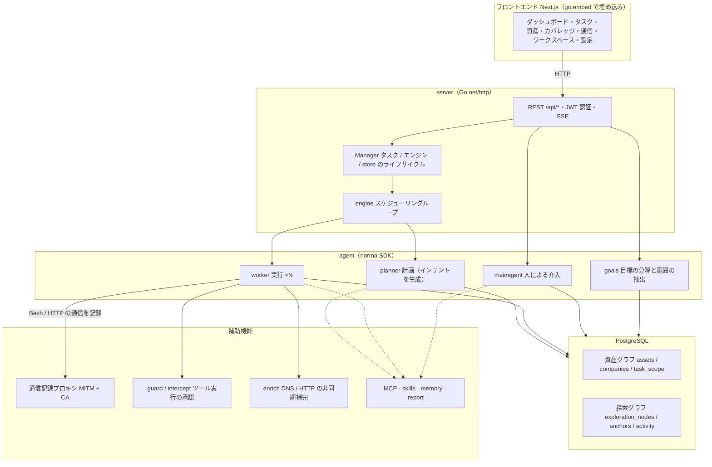
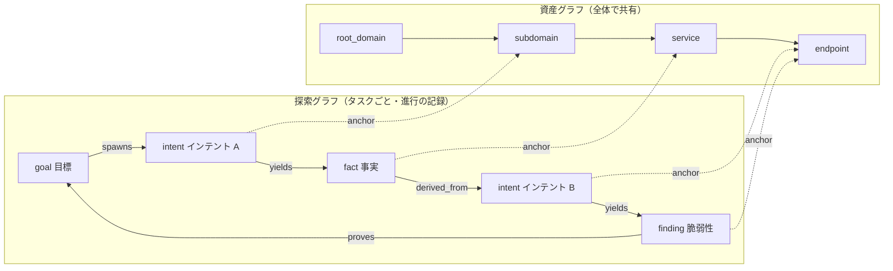
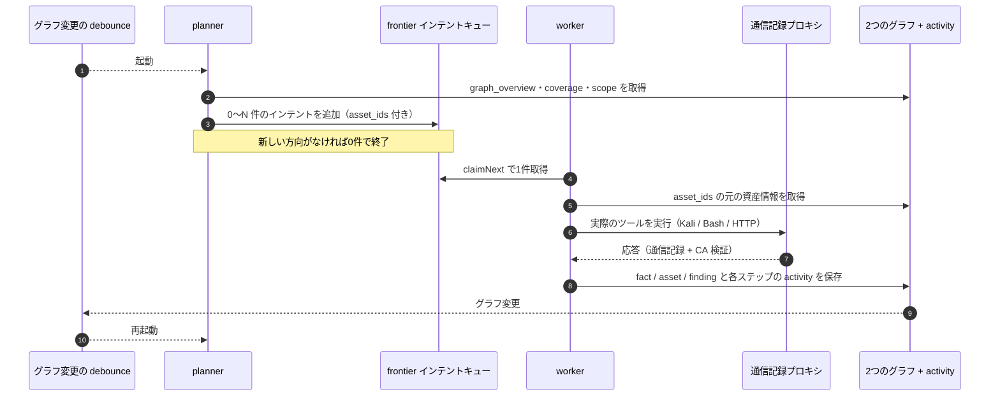
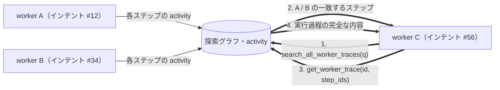
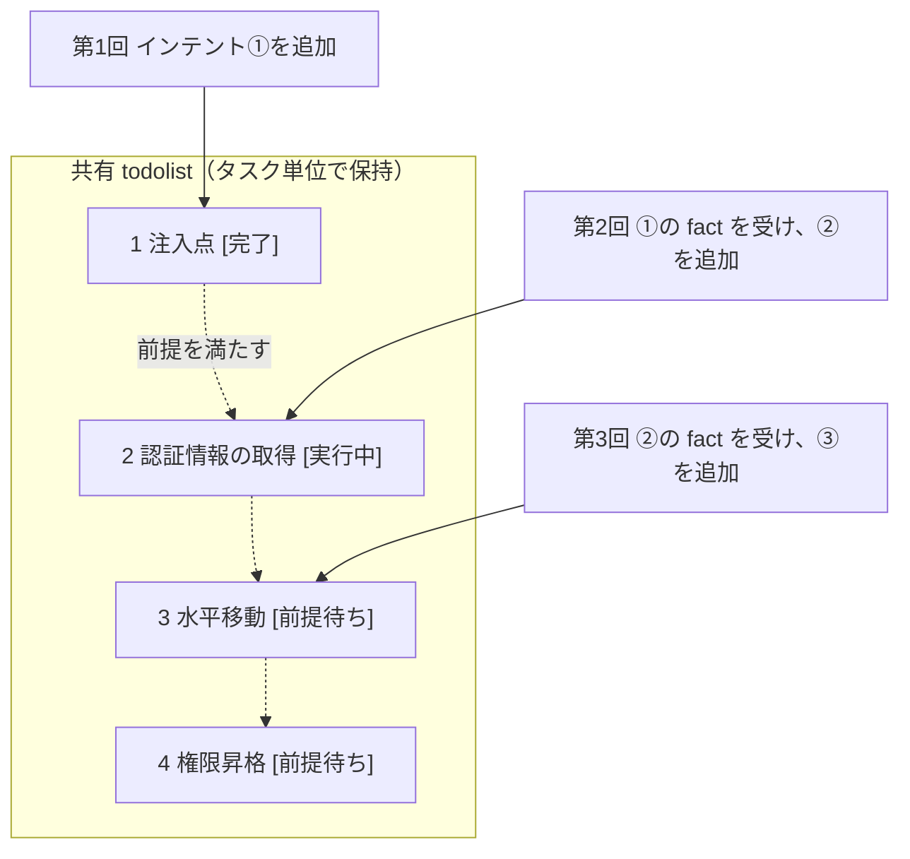

<div align="center">

# ARTEX-Japanese

AI による自律型ペネトレーションテストシステムの日本語版（Go バックエンド + Next.js フロントエンド）

このリポジトリは ARTEX の日本語化版です。元の中国語を日本語に翻訳し、元から英語の表示・説明・プロンプトは英語のまま保持します。

🌐 **元プロジェクトのオンラインデモ**：[ARTEX Demo](https://artex-demo.vercel.app/)

</div>

> オンラインデモと公開 Docker イメージ `autumn27/artex` は、このリポジトリの日本語版とは別の配布物です。日本語版を利用する場合は、以下の手順でこのリポジトリのソースをビルドしてください。保存済みのユーザーデータ、任意に編集したプロンプト、取得した通信内容は自動翻訳しません。

---

## スクリーンショット

画面写真13枚は、中国語のみを日本語化し、英語を保持した現在のモックデモで撮り直しています。日本語化の対象と互換性・検証の内容は [日本語化の確認結果](LOCALIZATION.md) を参照してください。

| ダッシュボード（概要 / Token 消費量 / アクティビティ） | タスク一覧 |
| :---: | :---: |
|  |  |

| タスクの実行過程（セッション / ツール呼び出し） | 探索経路 |
| :---: | :---: |
|  |  |

| 検出結果 | 資産 |
| :---: | :---: |
|  |  |

| 資産カバレッジ図（力学モデルによる配置・テスト済み資産の強調表示・ノードの折りたたみ） |
| :---: |
|  |

| トラフィックの記録 | 人が介入できるチャット |
| :---: | :---: |
|  |  |

| Agent 管理 | LLM 設定 |
| :---: | :---: |
|  |  |

| ブロックの承認 | バックエンドのログ |
| :---: | :---: |
|  |  |

## 承認記録の詳細

全体の「承認記録」、タスク内の「ブロックの承認」、チャット内の承認カードは、いずれも展開して詳細を確認できます。
表示構成は [AegisHook の承認詳細コンポーネント](https://github.com/RuoJi6/AegisHook/blob/main/web/src/components/CallDetail.vue)を参考にし、ARTEX のコンポーネントとテーマに合わせています。

## 資産の同期（ScopeSentry）

[ScopeSentry](https://github.com/Autumn-27/ScopeSentry) から資産を直接同期でき、同じ情報を再収集する必要がありません。

- 「**資産の同期**」画面に ScopeSentry のアドレスと API Key を入力し、データソースに接続します。
- **プロジェクト**または**タスク**単位で、同期する対象と資産の種類（サブドメイン / サービス / アプリ）を選択します。サブドメインには関連する IP、サービスには HTTP やポートの情報も含まれます。
- インポートした資産を企業の資産範囲に統合し、agent が探索に使用する資産グラフに追加します。

---

## インストール

データベースは **PostgreSQL** を使用します。探索には **LLM** の設定が必要です（`ANTHROPIC_API_KEY` / `OPENAI_API_KEY`、または画面の LLM 設定）。ソースのビルドには `go.mod` が指定する **Go 1.26.3 以降**と、フロントエンドをビルドできる **Node.js / npm** が必要です。CI では Node.js 22 を使用しています。

### 方法1：インストールスクリプト

```bash
git clone https://github.com/hara-kazu/ARTEX-Japanese.git
cd ARTEX-Japanese
./install.sh
```

スクリプトで次の方法を選択します。

- **Docker で導入**：PostgreSQL のパスワードを入力し（Enter で自動生成）、`.env` を作成して `docker compose up -d` を実行します。ただし、標準の Compose は元プロジェクトの公開イメージを使用します。日本語版のイメージを使う場合は、後述のローカルビルドが必要です。
- **ローカルでビルドして実行**：既存の PostgreSQL に接続するか、Docker でデータベースを起動します。`config.json` を作成し、日本語化したフロントエンドを含む実行ファイルをビルドします。**このリポジトリの日本語版には、こちらを選択してください。**

完了後は [http://localhost:8787](http://localhost:8787) を開きます。初回は `/setup` で管理者パスワードを設定します。

ローカル導入の最後は、スクリプトが実行ファイルを直接起動します。画面からの更新と自動再起動を使う場合は、初回の実行を Ctrl-C で終了し、以降は `./start.sh` で起動してください。

### 方法2：ソースから単一実行ファイルをビルド

通常利用向けのビルドでは、`NEXT_PUBLIC_MOCK` を未設定または `0` にしてください。`1` の場合はバックエンドへ接続しないデモになります。

```bash
git clone https://github.com/hara-kazu/ARTEX-Japanese.git
cd ARTEX-Japanese

# 1. フロントエンドを静的ファイルとして出力
cd web && npm ci && npm run build:static && cd ..

# 2. 埋め込み用ディレクトリにコピー
mkdir -p server/webui/dist
cp -r web/out/. server/webui/dist/

# 3. フロントエンドを埋め込んでビルド
CGO_ENABLED=0 go build -tags embedui -o artex ./cmd/artex

# 4. データベースを設定して起動
cp config.example.json config.json
# config.json の database を接続先に合わせて編集
./start.sh
```

Windows では Go の出力ファイルを `artex.exe` とし、`start.bat` で起動します。PowerShell で静的ビルドを行う場合は、環境変数を次のように設定できます。

```powershell
Set-Location web
npm ci
$env:NEXT_EXPORT = "1"
npm run build
Remove-Item Env:NEXT_EXPORT
Set-Location ..
New-Item -ItemType Directory -Force server/webui/dist | Out-Null
Copy-Item web/out/* server/webui/dist/ -Recurse -Force
$env:CGO_ENABLED = "0"
go build -tags embedui -o artex.exe ./cmd/artex
Copy-Item config.example.json config.json
# config.json の database を編集してから起動
.\start.bat
```

`start.sh` / `start.bat` は、終了コードに応じて再起動する監視スクリプトです。画面からの更新・ロールバックもこの仕組みを利用します。実行ファイルを直接起動した場合、更新後の自動再起動は行われません。

バックグラウンドで常駐させる場合：

```bash
nohup ./start.sh >artex.log 2>&1 &
```

### 方法3：Docker Compose

標準の `docker-compose.yml` は `autumn27/artex` を使用します。このイメージを取得するだけでは、本リポジトリの日本語化は反映されません。

元プロジェクトの公開イメージで起動する場合：

```bash
cp .env.example .env
# POSTGRES_PASSWORD と、必要に応じて ANTHROPIC_API_KEY などを設定
docker compose up -d
```

日本語版のイメージをローカルで作成する場合は、先にフロントエンドを埋め込んだ Linux バイナリを用意します。以下は amd64 の例です。arm64 では `GOARCH`、出力先、`TARGETARCH` を `arm64` に、`--platform` を `linux/arm64` に変更してください。ホストと異なる CPU 向けのビルドには、Docker の対応するエミュレーション環境が必要です。

```bash
# 方法2の手順で server/webui/dist を用意した後に実行
mkdir -p dist/amd64
CGO_ENABLED=0 GOOS=linux GOARCH=amd64 go build -tags embedui -o dist/amd64/artex ./cmd/artex
docker build --platform linux/amd64 --build-arg TARGETARCH=amd64 -t artex-japanese:local .
cp .env.example .env
# .env の POSTGRES_PASSWORD を設定
```

`docker-compose.override.yml` を作成して、アプリのイメージを指定します。

```yaml
services:
  artex:
    image: artex-japanese:local
    pull_policy: never
```

```bash
docker compose up -d
# http://localhost:8787
```

イメージには ripgrep / curl / vim / npm / nmap などのツールが含まれます。`./skills` と `./data` はバインドマウントで保持します。ローカルイメージの更新時は再ビルドしてコンテナーを再作成してください。公開イメージ用の `docker compose pull` では日本語版を更新できません。

### 方法4：ビルド済みの実行ファイル（Releases）

[このリポジトリの Releases](https://github.com/hara-kazu/ARTEX-Japanese/releases) に対象プラットフォームの配布パッケージがある場合に利用できます。ソースだけが公開されている状態では、この方法は使用できません。

zip を展開すると、`artex`（Windows は `artex.exe`）、`start.sh` / `start.bat`、`skills/`、`config.example.json` が得られます。

```bash
cp config.example.json config.json
# database の接続情報を編集
./start.sh
```

### 方法5：複数プラットフォーム向けの Release パッケージ

`build.sh` はフロントエンドをビルドして埋め込み、Go linker でデバッグ情報を除去して zip にまとめます。標準の Release 対象は Linux amd64 / arm64、macOS amd64 / arm64、Windows amd64 です。スクリプトは Bash、rsync、zip などを使用します。

```bash
./build.sh --release
# 出力先：dist/artex-<バージョン>-<os>-<arch>.zip
```

UPX の自己展開形式は、一部の Linux カーネル、仮想環境、セキュリティ設定と互換性がないため、標準では無効です。対象を `ARTEX_TARGETS` で指定でき、実行環境での互換性を確認した場合は `--upx` を使用できます。

```bash
ARTEX_TARGETS=linux/amd64,windows/amd64 ./build.sh --release
./build.sh --target linux/amd64 --upx
```

### リモート MCP の接続

MCP 設定では `http`（Streamable HTTP）または `sse`（旧形式の SSE）を選択できます。
旧形式では通常 `GET /sse` でイベントストリームを開き、サーバーが返す `/message?sessionId=...` で JSON-RPC リクエストを受け付けます。URL に `/sse` を指定し、必要なヘッダーを `Authorization=Bearer <token>` の形式で入力してください。

---

## 更新

更新ではプログラムを置き換え、PostgreSQL の `pgdata`、`./data`、`./skills`、設定ファイルを保持します。データベースのスキーマは起動時に `schema.sql` を冪等に適用します（`ADD COLUMN` / `CREATE INDEX IF NOT EXISTS` を含む）。手動でのマイグレーション実行は不要です。更新前にデータベースと `./data` をバックアップしてください。

### 日本語版の Release 更新元

画面からの更新は [hara-kazu/ARTEX-Japanese の Releases](https://github.com/hara-kazu/ARTEX-Japanese/releases) を参照します。ソースの clone / pull もこのリポジトリを使用してください。Go module のパスは互換性のため元の `github.com/Autumn-27/artex` を保持しています。

非公開リポジトリを使用する場合は、バックエンドの環境変数 `ARTEX_UPDATE_GITHUB_TOKEN` に対象リポジトリの **Contents: read** 権限を持つトークンを設定します。公開リポジトリへのアクセスでは必須ではありません。トークンはバックエンドが Release の照会とダウンロードに使用し、ブラウザーには送りません。Git にコミットしないでください。

```bash
# 必要な場合は、事前にプロセスの環境へ ARTEX_UPDATE_GITHUB_TOKEN を設定
./start.sh
```

`start.sh` は `.env` を自動読み込みしません。ローカル実行では変数をプロセスの環境に設定してください。Docker Compose では Git 管理外の `.env` に設定してアプリのコンテナーを再作成します。古いイメージに環境変数を加えるだけでは、更新元の実装は切り替わりません。

インストール可能な更新を提供するには、draft / prerelease 以外の正式な Release と、`artex-<バージョン>-<os>-<arch>.zip`、`SHA256SUMS` が必要です。ソースだけではオンライン更新できません。既存の Release ワークフローは `v*` タグの push で実行され、現在のリポジトリに添付ファイルを生成します。

### 方法1：画面から更新

「**システム設定**」（`/system/settings`）の「**バージョンと更新**」で新しいバージョンを確認・インストールできます。

更新の流れは、対象プラットフォームの配布ファイルをダウンロード → `SHA256SUMS` と照合 → 新しい実行ファイルを `-h` で動作確認 → `artex.new` として一時保存 → 終了後に監視スクリプトが再起動して適用、となります。画面は新しいサービスの起動後に自動更新されます。

- 検証や動作確認に失敗した場合は、一時ファイルを破棄して現在のバージョンを使用します。適用後に3回連続で起動に失敗すると `artex.old` に戻し、失敗した版を `artex.failed` として保持します。
- 前のバージョンは `artex.old` に保持され、「前のバージョンに戻す」から復元できます。データベースのスキーマは戻りません。
- 更新は再起動を伴い、実行中のタスクを中断します。
- `dev` や `git describe` の接尾辞付きバージョンでは、開発用の実行ファイルを上書きしないよう画面からの更新を無効にします。
- Docker 内の更新はプログラム本体のみです。playwright / nmap などのツールは更新せず、コンテナー再作成時にはイメージに含まれる版に戻ります。日本語版のローカルイメージは再ビルドして更新してください。
- GitHub への接続にプロキシが必要な場合は、同じ画面の「全体のプロキシ」を設定します。ダウンロード先は GitHub 関連ドメインに限定し、HTTPS を必須にしています。

### 方法2：更新スクリプト

```bash
cd ARTEX-Japanese
./update.sh
```

必要に応じて `git pull --ff-only` でソースを取得し、Docker 更新またはローカルでの再ビルドを選択します。

- **Docker**：公開イメージを使用する構成では、タグを選び `docker compose pull` / `docker compose up -d` を実行します。日本語版のローカルイメージを使う場合は、先に上記の方法でイメージを再ビルドしてください。
- **ローカル**：フロントエンドと実行ファイルを再ビルドします。完了後に起動中のプロセスを再起動してください。

### 方法3：実行ファイルを手動更新

[Releases](https://github.com/hara-kazu/ARTEX-Japanese/releases) から新しい zip を取得し、既存のプロセスを停止して `artex` と `skills/` を置き換えます。`config.json` と `data/` は保持してください。

```bash
cp -r <展開先>/skills ./
cp <展開先>/artex ./
./start.sh
```

### 方法4：ソースから更新

```bash
git pull --ff-only
cd web && npm ci && npm run build:static && cd ..
mkdir -p server/webui/dist
cp -r web/out/. server/webui/dist/
CGO_ENABLED=0 go build -tags embedui -o artex ./cmd/artex
# 起動中のプロセスを停止して ./start.sh を再実行
```

---

## 設定

**データベース**：`config.json`、または環境変数 `ARTEX_PG_DSN` で指定します。環境変数が優先されます。

```json
{
  "database": {
    "host": "127.0.0.1",
    "port": 5432,
    "user": "artex",
    "password": "yourpass",
    "dbname": "artex",
    "sslmode": "disable"
  }
}
```

**LLM**：`ANTHROPIC_API_KEY` または `OPENAI_API_KEY` を環境変数に設定するか、画面の「LLM」で設定します。必要に応じて `ARTEX_LLM_PROVIDER` / `ARTEX_LLM_MODEL` / `ARTEX_LLM_BASE_URL` / `ARTEX_LLM_PROXY` も使用できます。

**同時実行数**：各タスクの work agent 数は「システム設定」で設定します（デフォルト3）。

**起動パラメーター**：`./start.sh -addr :8787 -proxy 127.0.0.1:8788`。`-addr` はフロントエンドと API、`-proxy` は通信記録プロキシの待ち受け先です。監視スクリプトは引数をそのまま実行ファイルに渡します。

### リバースプロキシでの公開（HTTPS / ポート443のみ）

フロントエンド、API、SSE は同じバックエンドのポート（デフォルト `:8787`）から配信します。リアルタイムのアクティビティも同一オリジンを使用するため、通常は `NEXT_PUBLIC_SSE_BASE` の設定は不要です。外部には443のみを公開し、8787は内部に配置できます。

SSE は長時間接続してイベントを送信します。リバースプロキシのバッファーを無効にしないと、接続できてもイベントが届きません。Nginx の例：

```nginx
server {
    listen 443 ssl;
    server_name your.domain.com;
    # ssl_certificate / ssl_certificate_key ...

    location / {
        proxy_pass http://127.0.0.1:8787;
        proxy_set_header Host $host;
        proxy_set_header X-Forwarded-Proto $scheme;

        # SSE 用：バッファー無効、長いタイムアウト、HTTP/1.1
        proxy_buffering off;
        proxy_cache off;
        proxy_read_timeout 3600s;
        proxy_http_version 1.1;
        proxy_set_header Connection "";
    }
}
```

SSE を別オリジン（独立したサブドメインなど）へ接続する場合に限り、**ビルド時**に `NEXT_PUBLIC_SSE_BASE` を設定します。この値は `next build` で静的ファイルに組み込まれるため、ビルド済みコンテナーの実行時に設定しても反映されません。

---

## 開発

### 脆弱性の手動再テスト

タスク詳細の「再テスト」で、このタスクの脆弱性をページ単位で選択し、過去の結論と証拠を確認したり、新しい再テストを開始できます。開始後も現在の画面を保持し、スピナーと「再テスト中」を表示します。

検出結果一覧の各行の「再テスト」、または脆弱性の詳細にある「脆弱性の再テスト」から開始します。修正バージョン、テスト条件、制約は任意で入力できます。独立した Agent のセッションを作成するため、元の探索タスクを再開する必要はありません。一覧表示、タスク別、資産別の各表示から利用できます。

結論は「再現可能」「修正済み」「確認不可」です。毎回の結論、証拠、セッションへのリンクを脆弱性の詳細に保持します。「再テスト中」から対応するセッションを開けます。

バックエンドの初回起動時には、編集可能な再テスト（`retester`）Agent を用意します。「Agent 管理」でプロンプト、LLM、実行予算、ツールを設定できます。関連付けた LLM を優先し、未指定なら全体の有効な設定を使用します。正常完了して修正を確認した場合にのみ、脆弱性の処理状態を自動的に「修正済み」へ変更します。実行中、失敗、停止、それ以外の結論では元の状態を保持します。元の証拠とレポートも保持します。処理状態は手動で変更することもできます。

同じ脆弱性の再テストが実行中の場合は、既存のセッションを使用します。停止、失敗、サービス再起動後は再度開始できます。現時点で再テストの履歴は脆弱性の詳細とセッションから確認するもので、レポートのエクスポート、タスクのアーカイブ、自動的な通信証拠の関連付けには含まれません。デモモードは明示的な模擬記録を生成するだけで、実際の対象にリクエストしません。

### ローカル実行とテスト

```bash
./dev.sh
# バックエンド :8787 / 通信記録プロキシ :8788 / Next.js :3000
```

- バックエンド：`go run ./cmd/artex`。`-tags embedui` を付けなければフロントエンドを埋め込みません。
- フロントエンド：`cd web && npm run dev`。`/api` はバックエンドへプロキシし、ホットリロードを使用します。
- Go テスト：`go test ./...`。PostgreSQL を必要とするテストは各パッケージの設定に従います。
- フロントエンドの型チェック：`cd web && npx tsc --noEmit`。
- フロントエンドの単体テスト：TypeScript の型除去に対応する Node.js 環境で `node --test web/src/lib/*.test.mjs`。
- Mock プレビュー（バックエンド不要）：`cd web && NEXT_PUBLIC_MOCK=1 npm run dev`。PowerShell では先に `$env:NEXT_PUBLIC_MOCK = "1"` を設定します。

---

## システム構成

ARTEX は **LLM と複数の agent による自律型ペネトレーションテストシステム**です。Next.js のフロントエンドを埋め込む Go バックエンドと PostgreSQL で構成し、agent には [`norma`](https://github.com/Autumn-27/norma) SDK（`agentcore` / `tool` / `permission` / `harness` / `memory` / `transcript`）を使用します。

中核は、資産と探索を分ける**2つのグラフ**です。その上で、**worker 間で実行過程の情報を共有する仕組み**と、**planner が複数回の計画で共通の todolist を使う仕組み**を組み合わせます。

### 全体のレイヤー



| レイヤー | 役割 |
| --- | --- |
| **フロントエンド** | Next.js の静的出力を `go:embed` で埋め込み。タスク、資産、探索経路、カバレッジの表示と、人が介入するチャット |
| **server** | `net/http` のルーティング、JWT 認証、SSE。`Manager` がタスク、エンジン、DB store のライフサイクルを管理 |
| **engine** | タスクごとに `plannerLoop` と N 個の worker goroutine。インテントの割り当て、タイムアウト、一時停止、終了処理 |
| **agent** | goals / planner / worker / mainagent。`ToolSet` を通じて2つのグラフを LLM のツールとして公開 |
| **db** | pgx を使用して PostgreSQL に永続化。埋め込んだスキーマを起動時に冪等に適用 |
| **補助機能** | 記録用 MITM プロキシ、承認、非同期補完、MCP、スキル、メモリー、レポート |

### 資産グラフと探索グラフ

「対象は何か」と「どこまでテストしたか」を別のグラフで管理し、アンカーで関連付けます。

- **資産グラフ（Asset Graph、全タスクで共有）**：`root_domain / subdomain / ip / service / app / endpoint` のノードと所属企業を管理します。親子関係や重複判定 key はプログラムで計算し、agent は元の情報を登録します。
- **探索グラフ（Exploration Graph、タスクごとに独立）**：`goal（目標）/ intent（インテント）/ fact（事実）/ finding（脆弱性）/ hint（ヒント）` を、`spawns / derived_from / yields / proves` などで接続します。どの事実から探索方向が生まれ、何を得たかを追跡できます。
- **アンカー**：`exploration_anchors(node_id, asset_id)` でインテント、事実、脆弱性を具体的な資産へ関連付けます。探索側から対象資産を確認でき、資産側からテストしたインテントや得られた事実を逆引きできます。この情報をカバレッジと資産カバレッジ図にも使用します。



planner は探索グラフの状況と目標を確認し、未検証の新しい方向がある場合にインテントをキューへ追加します。worker は1つのインテントを取得し、実際のツールで実行して、新しい資産・事実・脆弱性をグラフへ書き戻すと終了します。

### エンジンとインテントのライフサイクル

エンジンはイベント駆動です。グラフの変更で planner を起動し、生成したインテントを worker が実行します。書き戻しで次の計画を起動し、`prove_goal` で目標を証明するまで繰り返します。



### worker 間での実行過程の共有

エラー、レスポンス、隠れたパラメーターなどの有用な観察が、正式な fact として保存される前に実行過程へ現れることがあります。重複した調査を避けるため、worker は同じタスクの別の worker の過程を検索できます。

- `search_all_worker_traces(q)`：他の worker の実行過程をキーワード検索します。自分のインテントのステップは除外し、結果に `intent_id` を含めます。
- `list_worker_traces` / `get_worker_trace(intent_id, step_ids=[…])`：実行済みの worker を確認し、特定のステップの完全な内容を取得します。

これにより、グラフに fact がなくても別の worker の観察を再利用できます。各 worker が担当するインテントの範囲は変えず、実行過程を単位として情報を共有します。



### planner が複数回の計画で共有する todolist

検証の経路には、注入点の発見 → 認証情報の取得 → 水平移動 → 権限昇格、といった依存関係があります。これらを一度に並列実行せず、planner がタスクごとに共有する計画用 todolist を使って順に進めます。

- グラフが変わるたびに新しいセッションで起動しますが、todolist はタスク単位で保持します。経路を一度記録し、以降の計画で依存関係を満たしたステップから割り当てます。
- 前提ステップが完了し、必要な fact が存在する次のインテントだけを追加します。進捗に応じて todolist を更新し、事実で確認できたステップを完了にします。



イベント駆動でセッション自体が状態を持たない場合でも、複数ステップの経路を重複や順序の逆転を避けて進められます。

---

## 元プロジェクトのコミュニティ

WeChat の公式アカウント **SecSentry** をフォローし、アカウント宛てにメッセージを送ると、元プロジェクトの交流グループへ参加できます。日本語版リポジトリの窓口とは異なります。

<div align="center">


</div>

## 参考

- [Cairn](https://github.com/oritera/Cairn)
- [元プロジェクト ARTEX](https://github.com/Autumn-27/ARTEX)

## ライセンスと免責事項

以下は元プロジェクトのライセンスおよび利用に関する記載を日本語にしたものです。ライセンスの正式な条文は [LICENSE](LICENSE) を参照してください。

### オープンソースライセンス

本プロジェクトは **GNU Affero General Public License v3.0（AGPL-3.0）** で提供します。利用、変更、配布が可能ですが、派生物も同じ AGPL-3.0 で公開する必要があります。変更したものをネットワーク経由で利用者に提供する場合も、対応する完全なソースコードをその利用者に公開する必要があります。

> オープンソースライセンス自体は利用目的を制限しません。以下の利用制限と免責事項は、作者による追加の取り決めと声明です。

**ARTEX は個人学習、コード研究、ローカル環境での技術検証のためのものです。オンラインのシステムやウェブサイトに対する実際のテストには使用できません。**

### 許可される利用範囲

- 本プロジェクトのソースの閲覧、学習、研究、およびローカルの隔離環境における技術原理の検証。
- 個人学習、学術研究、コードレビューなど、攻撃を伴わない用途。

### 禁止事項

- ウェブサイト、オンラインサービス、ネットワーク接続システムへのスキャン、探索、悪用、攻撃（許可の有無や自身の資産であるかを問いません）。
- 実際のペネトレーションテスト、攻防演習、本番環境での利用。
- 不正侵入、データ窃取、恐喝、サービス妨害、その他の破壊的または犯罪的な活動。
- 所在する国や地域の法律・法令に違反する行為。

### 法令遵守の責任

利用者は、所在する国や地域のサイバーセキュリティ、データ保護、コンピューター犯罪に関する法令を遵守する必要があります。中国本土では「サイバーセキュリティ法」「データセキュリティ法」「個人情報保護法」と関連する司法解釈を含みますが、これらに限りません。**利用によって生じる法的責任と結果は、利用者自身が負担します。**

### 免責事項

本プロジェクトは「現状有姿（AS IS）」で提供し、明示・黙示を問わず保証を伴いません。作者と貢献者は、適切な利用であるかを問わず、利用によって生じる直接・間接の損失、データ消失、システム損傷、法的紛争に責任を負いません。**ダウンロード、インストール、利用を行うと、上記の内容を読み、理解し、同意したものとみなします。**
