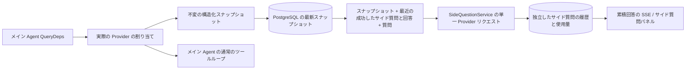

# ARTEX `/btw`

通常のチャット、タスクの MainAgent、現在のタスク自身の Worker は、独立したサイド質問に対応しています。メイン入力欄で `/btw 質問` と入力すると送信でき、空の `/btw` または「サイド質問」ボタンで履歴を開きます。デスクトップでは幅を調整できるサイドバー、モバイルでは Drawer を使用します。

サイド質問の回答は、送信時の Agent のコンテキストのスナップショットから生成され、ストリーミング表示、追加質問、停止、消去に対応しています。パネルを閉じる、ページを更新する、SSE を切断する操作では、モデルへのリクエストは取り消されません。停止は現在のサイド質問だけに作用します。消去するとサイド質問を取り消して履歴を削除し、メインコンテキストのスナップショットは保持します。

## 実装の範囲

Go、norma v0.3.7、Next.js、既存の Markdown / ResizablePanel / Drawer / AlertDialog コンポーネントを使用しています。norma のソースの変更や、サイド質問用の依存関係の追加はしていません。Planner、他のタスクから継承した Worker、ツール型サブタスクの更新は今回の範囲に含みません。

- `capture.go` は `Options.Deps.CallModel / CallModelSync` でのみメインループのリクエストを識別します。Provider のデコレーターは、ルーティングプールの外側での選択後、具体的なモデルの内側に配置されるため、実際に選択されたモデルを記録します。圧縮や要約のリクエストはスナップショットを上書きしません。
- リクエストの開始時、完全なモデルの応答時、実行の最終状態でスナップショットを公開します。生成途中の応答は公開しません。ツール呼び出しは norma の `MessagesForAPI` で対応を保持し、ツール結果は次のメインモデルへのリクエスト時か実行の最終状態でスナップショットに入ります。ストリーミングの中止時は、直前の有効な境界を保持します。
- スナップショットは JSON のディープコピーで、構造化メッセージ、システムプロンプト、ツール定義、生成パラメーターを保持します。モデルの推論中は、スナップショットのロックやデータベースのトランザクションを保持しません。
- `SideQuestionService` は具体的な Provider を呼び出します。必要に応じて先にサイド質問の要約を生成し、最終回答では、最初のコンテキスト超過時に、まだテキストやツール呼び出しを出力していない場合だけ、縮小後に1回再試行できます。agent session は作成せず、ツール実行器、メイン transcript、アクティビティのストリーム、タスクグラフには接続せず、タスクのモデル切り替えチェーンも経由しません。回答にツール定義を保持するのは、既存の構造化されたツールコンテキストとの互換性のためです。要約リクエストにはツールを提供しません。新しく返されたツール呼び出しに実行経路はありません。
- 親セッションごとに実行中のリクエストは1件、単一のサービスプロセス全体では最大4件で、1回のタイムアウトは120秒です。サイド質問には、サービスのライフサイクルに属する独立した取り消しコンテキストを使用します。
- サイド質問のリクエストは、モデル設定への参照と機密でない識別情報の要約を保持し、リクエスト時に既存の設定から認証情報を取得します。設定が削除された場合や、モデル、プロトコル、アドレスなどの識別フィールドが変わった場合は、先にメイン Agent を実行してスナップショットを更新する必要があります。テストによって製品の既定モデルを変更することはありません。

## 永続化と復元

`db/schema.sql` は `side_question_sessions` と `side_question_requests` を自動作成します。前者は親リソース、最新のスナップショット、実行番号、バージョン、消去バージョンを保存し、後者は質問、累積回答、状態、モデル、スナップショットの時刻、使用量、イベントの連番、ページ分割用の連番を保存します。

親セッションのキーには conversation ID、または task ID + exploration ID + intent ID を使います。Worker の命名には、再利用可能な実行スロットを使いません。

スナップショットは親セッションごとにまとめ、250 ms ごとに書き込みます。データベースは `(run_id, version)` を比較して、古いバージョンによる上書きを防ぎます。サイド質問の送信前に、選択されたスナップショットを再保存します。保存に成功したらメモリー内の大きなスナップショットを解放し、失敗したら書き込み待ちのバージョンを保持します。回答の累積内容は、ストリーミングイベントの到着時に250 ms ごとに最大1回書き込み、最終状態は直ちに保存し、データベースエラー時には回数を制限して再試行します。

サービスの起動時には、残っている `running` リクエストを `interrupted` にし、保存済みの部分回答と使用量を保持します。リクエストは自動再実行しません。最後に保存に成功したコンテキストを、次の質問に直接使えます。古いセッションにスナップショットがない場合は、先にメイン Agent を実行する必要があり、UI のアクティビティ記録からコンテキストを再構築しません。

消去操作は消去バージョンを増やしてリクエストを削除します。条件付き更新により、遅れて到着したコールバックの再書き込みを防ぎます。親リソースの物理削除には外部キーの連鎖削除を使い、Worker の論理削除では同一トランザクション内でサイド質問のデータを削除し、その後に遅れて届くスナップショットを拒否します。タスクのアーカイブでは、新しいリクエストを先に止め、メインの処理の停止を待ち、サイド質問を取り消して保存完了を待ちます。アーカイブ形式は v3 で、サイド質問のテーブルを含まない v1/v2 にも対応します。

履歴は完全に保存し、連番カーソルで1ページ最大20件を返します。モデルへのリクエストでは、成功した最近の質問と回答を最大20組、原文で再提示し、同時に token の予算で量を制限します。それより古い質問と回答には、独立した更新型の要約を保持します。メインコンテキストが予算を超えた場合は、サイド質問のコピーの古い部分だけを要約し、最近の構造化されたツール呼び出しと結果を保持します。要約、準備の進捗、使用量も、サイド質問の同時実行、取り消し、120秒のタイムアウトの制約に含みます。詳細は[コンテキストの予算とオープンソースの参考例](CONTEXT_BUDGET.md)を参照してください。

## HTTP の契約

以下のパスを `{parent}` とし、既存の認証とリソースの検証を使用します。

- `/api/conversations/{id}`
- `/api/tasks/{id}/chat`
- `/api/tasks/{id}/intents/{iid}`

| リクエスト | 戻り値と動作 |
| --- | --- |
| `GET {parent}/side-questions?before={ordinal}` | `items` は新しい順、独立した `current` の実行状態、`snapshot` のメタ情報、`next_cursor`。カーソルの 0 は最新ページ / 次のページなしを表します |
| `POST {parent}/side-questions` | JSON `{ "question": "…", "client_request_id": "UUID" }`。新しいリクエストは 202 とリクエストオブジェクトを返し、同じ ID と質問には既存のオブジェクトを 200 で返します |
| `DELETE {parent}/side-questions` | 現在の親セッションのサイド質問と回答を取り消して消去します |
| `GET /api/side-questions/{requestID}/events` | `snapshot` SSE イベント。`id` は増加する連番、`data` は完全な累積リクエストオブジェクトです。消去時には `cleared` を送信します |
| `POST /api/side-questions/{requestID}/cancel` | 明示的に取り消します。最終状態は履歴または SSE から取得できます |

質問は最大4000文字です。スナップショットがない、モデル設定が変わった、同じ親セッションが処理中、冪等性 ID が競合する場合は 409、全体の同時実行上限に達した場合は 429 を返します。SSE 接続ごとに、クライアントが以前に受け取ったテキスト片に依存せず、最初に累積状態を送信します。フロントエンドはリクエスト ID + 連番で統合し、親セッションの切り替え時や消去時に、古いコールバックを破棄します。

## 検証と参考

自動チェック、実際のモデルの使用、既知の制限は [VALIDATION.md](VALIDATION.md) を参照してください。

独立したリクエストの参考は [Grok CLI side-question.ts（固定コミット）](https://github.com/superagent-ai/grok-cli/blob/fb97af83f06dca873281d60168430f06c8de6324/src/utils/side-question.ts)、実行の分離の参考は [OpenCode（固定コミット）](https://github.com/anomalyco/opencode/tree/b3f1a96c6dd7adeb28b36dd11add1998fc84d67b) です。ARTEX のコンテキストには norma の構造化メッセージを使用し、フロントエンドのログから文章を組み立てる方式は採用していません。
