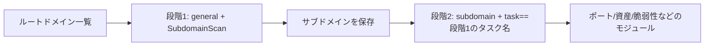

---

## name: scopesentry-mcp
description: ScopeSentry MCP を使ってセキュリティスキャン基盤（プロジェクト、タスク、テンプレート、資産、ノード）を管理します。ユーザーが ScopeSentry、MCP、API Key、スキャンタスク、資産検索に言及した場合に使用します。

# ScopeSentry MCP 利用ガイド

**ScopeSentry のインスタンスを配備済み**のユーザー向けです。Cursor（または他の MCP クライアント）で基盤に接続し、ローカルのソースコードは不要です。

## 1. 準備

### 1.1 サービスへの接続を確認

- 既定の Web 画面：`http://<ホスト>`
- MCP エンドポイント：`http://<ホスト>/mcp`（手前にリバースプロキシやフロントエンドのプロキシがある場合は、実際の `/mcp` アドレスを使用）

### 1.2 API Key の作成

1. ブラウザーで ScopeSentry の Web 画面にログイン
2. **API Key** の管理ページでキーを作成（または管理者が提供するインターフェースで作成）
3. 返された `ssk_...` の文字列を保存（**一度だけ表示**）

### 1.3 Cursor MCP の設定

Cursor → Settings → MCP → サーバーを追加：

```json
{
  "mcpServers": {
    "scopesentry": {
      "url": "http://<あなたのホスト>:8082/mcp",
      "headers": {
        "X-API-Key": "ssk_あなたのキー"
      }
    }
  }
}
```

次も使用可能：`Authorization: Bearer ssk_あなたのキー`

設定後に MCP を再起動するか Cursor を再読み込みし、ツール一覧に `list_projects`、`list_assets` などが現れることを確認してください。

---

## 2. ツール一覧


| ツール                     | 用途                |
| ---------------------- | ----------------- |
| `list_projects`        | タグごとのプロジェクトツリー（プロジェクト ID を含む） |
| `list_projects_data`   | ページ分割したプロジェクト一覧。名前で検索可能     |
| `get_project`          | プロジェクトの詳細              |
| `create_project`       | プロジェクトの新規作成              |
| `list_tasks`           | スキャンタスクの一覧            |
| `get_task`             | タスクの詳細              |
| `list_scan_templates`  | スキャンテンプレートの一覧            |
| `get_scan_template`    | テンプレートの詳細              |
| `list_plugin_modules`  | スキャンのパイプラインのモジュール名          |
| `list_plugins`         | 利用可能なプラグイン（hash、既定のパラメーターを含む） |
| `create_scan_template` | スキャンテンプレートの作成            |
| `create_scan_task`     | スキャンタスクの作成            |
| `list_assets`          | 各種資産の検索（ページ分割した一覧）       |
| `count_assets`         | 資産数の集計（`/api/assets/common/total`） |
| `get_asset_detail`     | 資産または脆弱性の詳細           |
| `add_asset_tag`        | 資産にタグを追加           |
| `list_nodes`           | スキャンノードの一覧            |


各ツールのパラメーターは MCP ツールの説明（schema）を基準にしてください。`list_assets` / `count_assets` の search、filter の構文は共通です。資産の検索前に `list_assets` の description を読むことができます。

「合計何件か」を知りたい場合は `count_assets`（Web のページ分割の総数に対応するインターフェース）を使い、総数を数えるために `list_assets` のページを何度も切り替える必要はありません。

---

## 3. よく使う作業の流れ

### 3.1 プロジェクト単位で資産を検索

ユーザーまたはコンテキストに**すでにプロジェクトの条件がある**場合は、優先して `filter.project` で範囲を絞り、プロジェクトをまたぐ大量のデータで応答が遅くなるのを避けてください。明確なプロジェクトがない場合は、プロジェクトによる絞り込みを強制する必要はありません。

1. `list_projects` または `list_projects_data` で対象プロジェクトの **ObjectID**（`id` / `children[].value`）を取得
2. `list_assets` に `filter.project` を指定（**必ず ID を使い、プロジェクトの中国語名は指定しない**）

```json
{
  "asset_type": "asset",
  "pageIndex": 1,
  "pageSize": 20,
  "search": "domain=^example.com",
  "filter": {
    "project": ["<プロジェクトObjectID>"]
  }
}
```

### 3.2 スキャンタスクの作成

1. `list_nodes` でオンラインのノード名を取得
2. `list_scan_templates` または `create_scan_template` でテンプレートの **ObjectID** を取得
3. `create_scan_task`：`name`、`node` は必須。`template` はテンプレート ID を指定（テンプレート名は不可）

**対象の取得元 `targetSource`（Web と共通）：**

| targetSource | 説明 | 必須パラメーター |
| --- | --- | --- |
| `general` | 対象を直接入力 | `target` |
| `project` | プロジェクトから対象を取得 | `project`（プロジェクトの ObjectID 配列） |
| `asset` | Web の資産データベースから検索 | `search`。任意で `project`、`filter`、`targetNumber` |
| `RootDomain` | ルートドメインのデータベースから検索 | `search`。任意で `project`、`filter`、`targetNumber` |
| `subdomain` | サブドメインのデータベースから検索 | `search`。任意で `project`、`filter`、`targetNumber` |
| `UrlScan` | URL のスキャン結果から検索 | `search`。任意で `project`、`filter`、`targetNumber` |
| `*Source`（例：`subdomainSource`） | 資産ページの「選択/検索」から作成 | `targetTp=search` では `search`、`targetTp=select` では `targetIds` を使用 |

**例 — ルートドメインを直接スキャン：**

```json
{
  "name": "example-サブドメイン収集",
  "node": ["node-1"],
  "template": "<テンプレートObjectID>",
  "targetSource": "general",
  "target": "example.com\nfoo.com",
  "project": ["<プロジェクトObjectID>"]
}
```

**例 — サブドメインのデータベースから継続してスキャン（前のタスク名で絞り込み）：**

```json
{
  "name": "example-ポートと脆弱性",
  "node": ["node-1"],
  "template": "<後続モジュール用テンプレートObjectID>",
  "targetSource": "subdomain",
  "search": "task==\"example-サブドメイン収集\"",
  "project": ["<プロジェクトObjectID>"]
}
```

### 3.3 ルートドメインの網羅的な情報収集（二段階を推奨）

入力が**ルートドメイン**で、**網羅的な情報収集**を行う場合は、パイプライン全体を一度に実行せず、二回に分けてスキャンすることを推奨します。

**理由：** 分散タスクは**個々の対象**を単位として割り当てます。ルートドメインを対象にすると、割り当てられたノードで見つかったサブドメインも同じノードで後続のモジュールを実行するため、負荷の偏り、速度の低下、エラーが発生しやすくなります。

**推奨する方法：**

1. **第一段階 — サブドメインの収集のみ**
   - `targetSource`: `general`
   - `target`: すべてのルートドメイン（複数行）
   - テンプレート：`SubdomainScan`、`SubdomainSecurity` のみを有効化（サブドメインのスキャン + サブドメインの乗っ取り）
   - `get_task` でタスクの完了を待つ

2. **第二段階 — 後続モジュール**
   - `targetSource`: `subdomain`
   - `search`: `task=="<第一段階のタスク名>"`（タスク名の完全一致）
   - 任意で `project` を指定して範囲を絞る
   - テンプレート：ポートスキャン、資産の把握、脆弱性スキャンなど（SubdomainScan を含めなくてもよい）
   - サブドメインを独立した対象として各ノードに割り当て、並列実行の効率を高める

Web 画面の「サブドメイン」資産ページでタスク名により絞り込み、「サブドメインからタスクを作成」を使用しても同じ結果になります。



### 3.4 スキャンテンプレートの作成

1. `list_plugin_modules` → モジュール名の一覧
2. `list_plugins`（`module` で絞り込み可能）→ 各プラグインの `hash` と既定の `parameter`
3. `create_scan_template`：`modules` で「モジュール → プラグインの hash 配列」を指定

---

## 4. 資産の検索（`list_assets` / `count_assets`）

`count_assets` と `list_assets` は共通の `asset_type`、`search`、`filter` を使い、`{ "total": N }` を返します。Web の `/api/assets/common/total` に対応します。

```json
{
  "asset_type": "subdomain",
  "search": "task==\"あるタスク名\"",
  "filter": {"project": ["<プロジェクトObjectID>"]}
}
```

**性能上の推奨事項（`list_assets` / `count_assets` 共通）：** プロジェクトの条件がある場合は優先して `filter.project` で範囲を絞り、`search` ではインデックスがあるフィールドにできるだけ `==` の完全一致か `^` の前方一致（[4.3](#43-search-検索式)参照）を使ってください。広範囲に `=` の部分一致を使用して応答が遅くなるのを避けてください。プロジェクトのコンテキストがない場合は、プロジェクトによる絞り込みを強制しません。

`filter.project` に対応する種類は [4.4](#44-filter-完全一致の絞り込み) の表を参照してください。

### 4.1 資産の種類 `asset_type`

`asset`、`RootDomain`、`subdomain`、`app`、`mp`、`UrlScan`、`SensitiveResult`、`DirScanResult`、`crawler`、`vulnerability`、`PageMonitoring`、`IPAsset`、`SubdomainTakerResult`

別名の例：`web`→asset、`vuln`→vulnerability、`ip`→IPAsset、`url`→UrlScan

### 4.2 パラメーターの説明


| パラメーター                       | 説明                                      |
| ------------------------ | --------------------------------------- |
| `pageIndex` / `pageSize` | ページ分割。既定値 1 / 20                            |
| `search`                 | 検索式（次節参照）                              |
| `filter`                 | 完全一致の絞り込みの JSON（次節参照）                          |
| `sort`                   | UrlScan、DirScanResult のみ `length` による並べ替えに対応 |
| `sid`                    | SensitiveResult のみ：機密情報のルール名                |


`search` と `filter` は**併用可能**です。

### 4.3 search 検索式

独自の DSL（**SQL ではありません**）：


| 演算子  | 意味   | インデックス | 例                          |
| ---- | ---- | ---- | --------------------------- |
| `=`  | 部分一致（regex） | インデックスを使わない | `domain=example`            |
| `==` | 完全一致（同値） | **インデックスを使用** | `port==443`                 |
| `!=` | 除外   | — | `port!="80"`                |
| `&&` | かつ    | — | `domain==example.com && port==443` |
| `||` | または    | — | `title=admin || body=login` |


**インデックスと演算子：** `domain`、`ip`、`port`、`title` などのフィールドにはインデックスがありますが、利用できるのは **`==` の完全一致** または **値が `^` で始まる前方一致**（例：`domain=^example.com`）だけです。**`=` は regex の部分一致になるためインデックスを使用できず**、データ量が多いと遅くなります。

**すべての種類で共通の search フィールド：** `tag`、`task`（タスク名）、`rootDomain`

**search 内に project は指定できません**（無効、または `&&` と組み合わせるとエラー）。プロジェクトの絞り込みには `filter.project` を使用してください。

**各種類でよく使う search フィールド：**


| asset_type           | フィールド                                                                                  |
| -------------------- | ----------------------------------------------------------------------------------- |
| asset                | domain, ip, port, service, app, title, statuscode, icon, banner, type, body, header |
| RootDomain           | domain, icp, company                                                                |
| subdomain            | domain, ip, type, value                                                             |
| app                  | name, icp, company, category, description, url, apk                                 |
| mp                   | name, icp, company, category, description, url                                      |
| UrlScan              | url, input, source, resultId, type                                                  |
| SensitiveResult      | url, sname, body, info, md5                                                         |
| DirScanResult        | url, statuscode, redirect, length                                                   |
| vulnerability        | url, vulname, matched, request, response, level                                     |
| crawler              | url, method, body, resultId                                                         |
| PageMonitoring       | url, hash, diff, response                                                           |
| IPAsset              | ip, domain, port, service, webServer, app                                           |
| SubdomainTakerResult | domain, value, type, response                                                       |


**search の例：**

- `domain==www.example.com && port==443`（完全一致、インデックスを使用）
- `domain=^example.com`（前方一致、インデックスを使用）
- `ip==192.168.1.1`
- `task=="あるタスク名"`
- `level==high`（vulnerability）
- `statuscode==200`（DirScanResult）

部分一致による包含が必要な場合だけ `=` を使ってください。例：`title=admin`（インデックスを使用しないため、プロジェクトなどの条件と併用して範囲を絞ることを推奨）。

### 4.4 filter 完全一致の絞り込み

JSON オブジェクト：同じ key の複数の値は **OR**、異なる key は **AND** です。

**プロジェクトの条件がある場合は `project` を優先：** ユーザーまたはコンテキストでプロジェクトが明確で、asset_type が `project` に対応する場合は、指定して範囲を絞ってください。プロジェクトの情報がない場合は強制しません。


| filter key   | 意味       | 値の説明                                                     |
| ------------ | -------- | -------------------------------------------------------- |
| `project`    | 所属プロジェクト     | **ObjectID**。`list_projects` / `list_projects_data` で取得 |
| `task`       | 元のタスク     | **タスク名**。`list_tasks` の `name` を使用                         |
| `port`       | ポート       | 例：`"443"`                                                |
| `service`    | サービス/プロトコル    | 例：`"https"`                                              |
| `app`        | アプリのフィンガープリント     | 例：`"Nginx"`                                              |
| `icon`       | アイコンの hash  |                                                          |
| `statuscode` | HTTP ステータスコード | 主に asset 用                                               |
| `status`     | 状態       | UrlScan/DirScan の HTTP コード。脆弱性/機密情報の対応状況                       |
| `level`      | 脆弱性の重大度     | critical / high / medium / low / info                    |
| `type`       | 種類       | 例：サブドメインのレコードの種類 A、CNAME                                         |
| `color`      | 機密情報のルールの色   | SensitiveResult                                          |
| `sname`      | 機密情報のルール名    | SensitiveResult                                          |
| `tags`       | タグ       |                                                          |


**各種類で使用可能な filter key：**


| asset_type                            | filter key                                                      |
| ------------------------------------- | --------------------------------------------------------------- |
| asset                                 | project, port, service, app, icon, statuscode, type, task, tags |
| RootDomain                            | project, tags                                                   |
| subdomain                             | project, type, task, tags                                       |
| app / mp                              | project, tags                                                   |
| UrlScan                               | status, tags                                                    |
| DirScanResult                         | status, tags                                                    |
| SensitiveResult                       | status, color, sname, tags                                      |
| crawler                               | project, task, tags                                             |
| vulnerability                         | project, level, status, task, tags                              |
| PageMonitoring / SubdomainTakerResult | tags                                                            |
| IPAsset                               | project, port, service, app                                     |


**filter の例：**

```json
{"project": ["<プロジェクトObjectID>"], "port": ["443"]}
```

**組み合わせた検索の例：**

```json
{
  "asset_type": "asset",
  "search": "domain=^baidu && port==443",
  "filter": {"project": ["<プロジェクトObjectID>"]},
  "pageIndex": 1,
  "pageSize": 10
}
```

**注意：**

- プロジェクトの条件がある場合は優先して `filter.project` を指定（対応している場合）。プロジェクトのコンテキストがない場合は強制しない
- `filter.project` にプロジェクトの表示名を指定しない
- 既知の値には `==`、接頭辞には `^` を使う。大きなテーブルで `=` の部分一致を多用しない
- UrlScan の HTTP ステータスには `filter.status` を使用。DirScanResult は search の `statuscode==200` を使用可能
- SensitiveResult のルール名での検索：`search` に `sname=ルール名`、または `filter.sname` を使用

### 4.5 並べ替え sort

**UrlScan**、**DirScanResult** のみ対応：

```json
{"length": "ascending"}
```

他の種類は `sort` を無視し、既定の時刻順で並べ替えます。

---

## 5. スキャンテンプレートのモジュール名

`TargetHandler`、`SubdomainScan`、`SubdomainSecurity`、`PortScanPreparation`、`PortScan`、`PortFingerprint`、`AssetMapping`、`AssetHandle`、`URLScan`、`WebCrawler`、`URLSecurity`、`DirScan`、`VulnerabilityScan`、`PassiveScan`

---

## 6. トラブル対処


| 状況        | 対処                                                 |
| --------- | -------------------------------------------------- |
| MCP にツールがない   | URL、API Key、ScopeSentry の動作を確認                    |
| 401 / 403 | API Key を再作成または変更                                    |
| 資産が見つからない     | `filter.project` が ObjectID であることを確認。search に project を指定しない |
| テンプレート/タスクの作成が失敗 | `template` は必ずテンプレートの ObjectID。`node` はオンラインのノード名を指定            |
| 検索が非常に遅い/停止する   | プロジェクトがある場合は `filter.project` を指定。search のインデックス付きフィールドには `==` または `^` の接頭辞を使い、`=` は控える。`pageSize` を縮小 |


---

